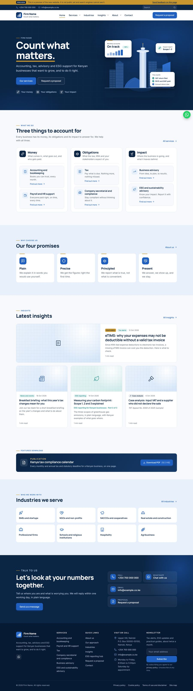

# Firm website

The website for a Kenyan accounting, tax, advisory and ESG firm, built by Ivula Technologies. It is a self-contained WordPress theme ("Count What Matters") that sets the whole site up on activation: every page, the 7 services, 8 industries, insights with tax case analyses, the ESG reporting hub, forms, SEO and the legal pages. No plugins are needed apart from one for SMTP email.



## Get the installable zip

- **Latest build:** open the newest green run under **Actions > CI** and download the `cwm-theme` artifact. It contains `cwm-theme.zip`.
- **Releases:** every tag such as `v1.1.0` publishes `cwm-theme.zip` under **Releases**. The tag must match `Version:` in `theme/cwm/style.css`.

Upload the zip in WordPress under **Appearance > Themes > Add New > Upload Theme**. On a site that already runs it, choose **Replace current with uploaded**; content and settings stay.

## Hosting and launch

The site runs on cPanel. [docs/SETUP-GUIDE.md](docs/SETUP-GUIDE.md) covers staging on Ivula Hosting, installing, email, going live and the client sign-off.

Key controls, all under **Firm settings** in WordPress:

| Control | Default | What it does |
|---|---|---|
| Preview mode | On | Hides the site from search engines, shows a "Preview" banner, optional password and feedback link. Untick on launch day. |
| Switch A: Audit | Hidden | Hidden / Partner / Live. While hidden, no audit wording appears anywhere. |
| Switch B: Team | Off | No staff names anywhere until switched on. |
| Launch checklist | | Lists everything still open before going live. |

## Repository layout

```
theme/cwm/            the WordPress theme (what goes in the zip)
  functions.php       loads inc/*
  inc/                settings, content types, switches, forms, SEO, preview mode, seed content
  page-templates/     Services, Industries, ESG hub, About, Approach, Team, Contact, Proposal, Site map
  template-parts/     shared blocks (closing CTA, case card)
  assets/             CSS, JS, self-hosted fonts, icons, images, sample PDFs
docs/                 setup guide and screenshots
.github/workflows/    CI (PHP 7.4 and 8.3 syntax check, zip build) and tagged releases
```

## Working on it

- Change the theme under `theme/cwm/`, bump `Version:` in `style.css` and `CWM_VERSION` in `functions.php` together, open a pull request into `main`, and tag a release after merging.
- Sample content is marked and can be deleted from the Launch checklist. Client details (firm name, logo, contacts) are placeholders until the client supplies them.

## Licence

Proprietary. Licensed to the client for use on its own website.
